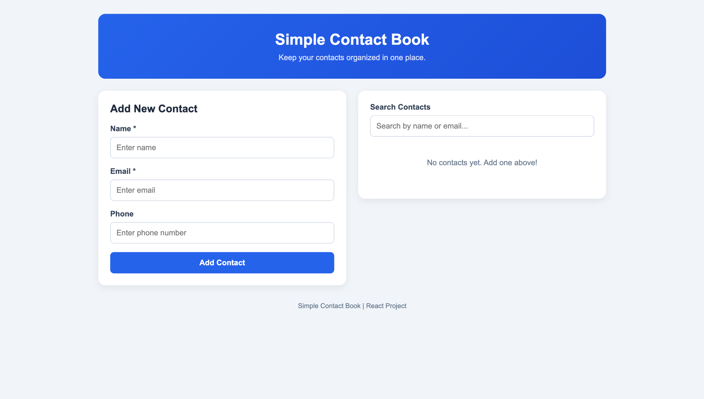
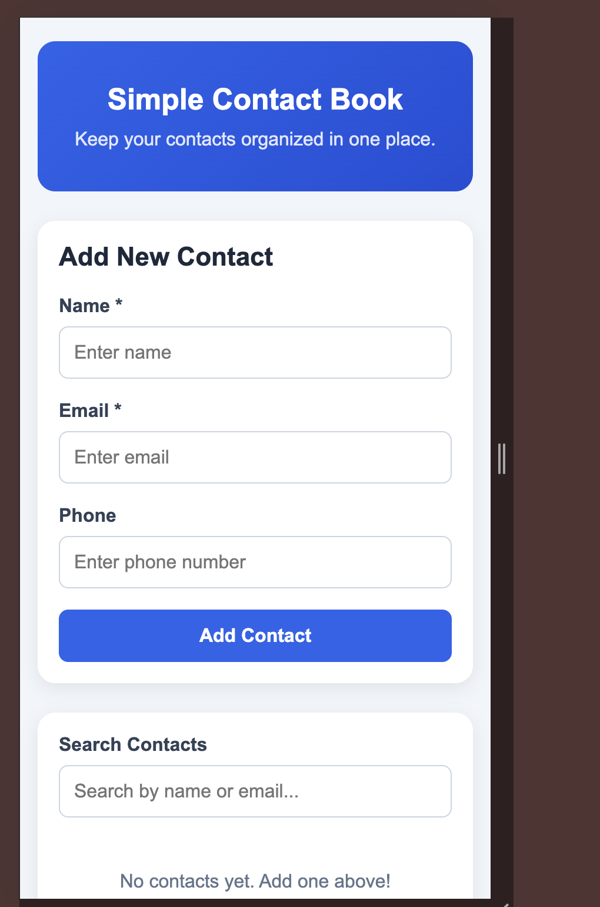
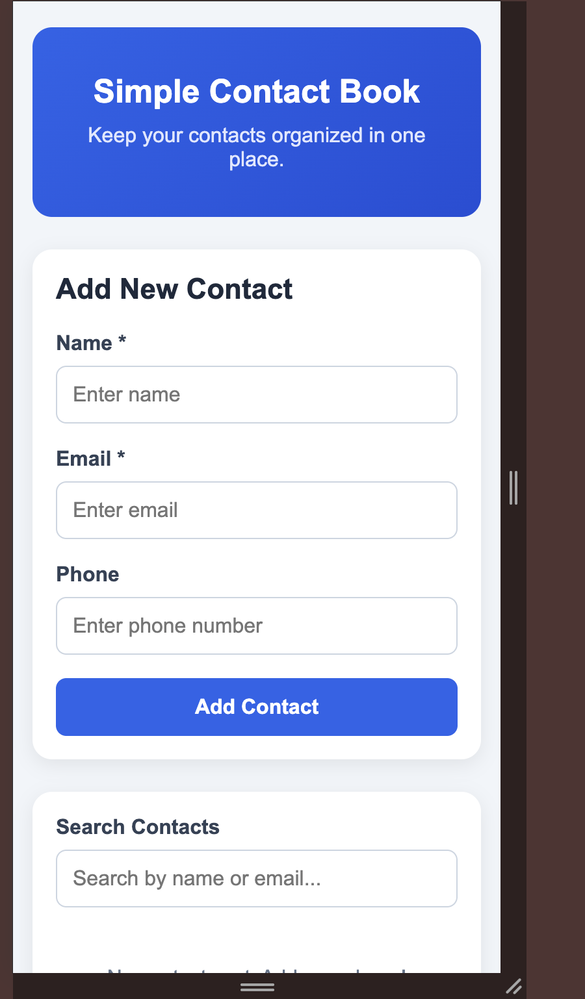

# Simple Contact Book

## Project Description

Simple Contact Book is a single-page React application
that allows users to add, search, view, and delete
contacts.

This project was created using React and Vite to
practice components, props, state, events, and
responsive web design.

## Features

- Add contacts with a name, email, and phone number
- View all saved contacts
- Search contacts by name or email
- Delete contacts
- Validate required form fields
- Display messages when no contacts are found
- Responsive design for desktop, tablet, and mobile

## Technologies Used

- React
- JavaScript
- JSX
- HTML
- CSS
- Vite

## How to Run the Project

1. Download or clone the repository.
2. Open the project folder in VS Code.
3. Open the terminal.
4. Run the following commands:

```bash
npm install
npm run dev
```

5. Open the local URL displayed in the terminal.

## Screenshots

### Desktop View


### Tablet View


### Mobile View


## React Concepts Used

- Components to organize the application
- Props to pass data between components
- useState to manage contacts and form inputs
- Controlled form inputs
- Event handling using onClick, onChange, and onSubmit
- map() to display contacts
- filter() to search and delete contacts
- Conditional rendering for messages

## Notes

Contacts are stored in React state during the session.
Refreshing the webpage resets the contact list.
No backend or database is required.
